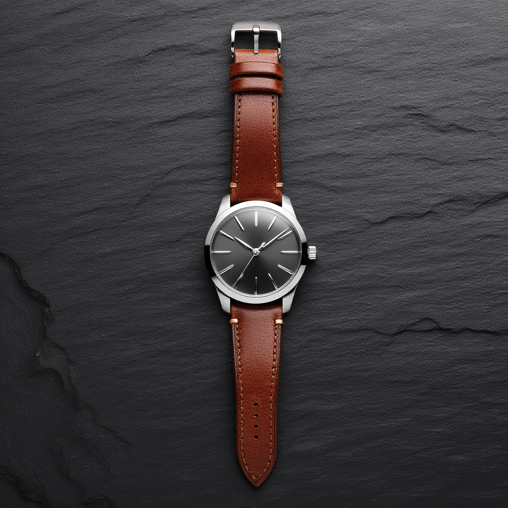

# Z-Image on Kaggle TPU v5e-8

[](https://github.com/dangkhoa2016/Z-Image-On-Kaggle-TPU-v5e8/actions/workflows/ci.yml)
[](https://github.com/dangkhoa2016/Z-Image-On-Kaggle-TPU-v5e8/actions/workflows/repository-audit.yml)

[](#production-architecture)
[](#production-architecture)
[](https://huggingface.co/Tongyi-MAI/Z-Image)
[](LICENSE)
[](docs/MODEL_LICENSE.md)

> 🌐 Language / Ngôn ngữ: **English** | [Tiếng Việt](README.vi.md)

Run the **full, undistilled 6.15B Z-Image transformer** on a free Kaggle **TPU v5e-8**, using all eight TPU devices through PyTorch/XLA SPMD. This repository turns a difficult-to-fit image-generation workload into a documented, benchmarked, reviewable execution path with production topology, high-resolution modes, tests, and frozen evidence.

The project is intentionally **not** a GGUF, quantized, or distilled port. Transformer inference stays in **BF16**. Prompt encoding and VAE decode remain CPU-side; transformer denoising runs on TPU.

## Why this project exists

Z-Image is large enough that “it starts on TPU” is not a useful engineering finish line. A practical implementation must answer harder questions: how to shard the transformer across the full v5e-8, how to generate multiple images concurrently, how far resolution can be pushed before HBM becomes the limiting factor, which topology should be used in normal operation, and how another independent reader can verify those claims.

This repository provides those answers as versioned code and evidence rather than as one-off notebook output.

## What this repository delivers

- A reusable **PyTorch/XLA BF16 inference path** for the full upstream Z-Image model.
- Manual **SPMD parameter sharding across all 8 TPU devices**; 521 transformer parameter tensors are sharded in the accepted runtime.
- A production mesh of **`(replica=4, model=2)`**, allowing four concurrent 1024×1024 outputs in one PJRT process.
- Resolution-aware execution modes: **batched CFG**, **sequential CFG**, and **full-context query-chunked attention**.
- A measured operating policy for 512, 768, and 1024 workloads, including the tested 1024 HBM boundary.
- High-resolution validation through **2560×2048 (5.24 MP)** without replacing full attention with local/window attention.
- CPU-safe regression tests, repository audit gates, machine-readable benchmark evidence, frozen seeds, output hashes, and accepted visual artifacts.
- Bilingual engineering documentation in English and Vietnamese.

For reading paths tailored to technical review, development, research, and people who only want to inspect results, see the [Project Guide](docs/PROJECT_GUIDE.md).

## Verified at a glance

| Capability | Verified result |
|---|---|
| Upstream model | `Tongyi-MAI/Z-Image`, full / undistilled |
| Transformer size | 6.15B parameters |
| Accelerator | Kaggle TPU v5e-8 / 8 devices |
| Precision | BF16 transformer inference |
| Sharded transformer tensors | 521 |
| Production topology | `(replica=4, model=2)` |
| 1024 production workload | 4 concurrent images / global batch 4 |
| Frozen 1024 benchmark | **90.264 s / 4 images** (`0.04431 img/s`) |
| Maximum safe tested batch at 1024 | **4** |
| Maximum validated resolution | **2560×2048 / 5.24 MP** |

The frozen 1024 benchmark corresponds to 22.566 s/image when throughput is amortized across the four concurrent outputs. A fresh Kaggle TPU execution of the same four-seed workload completed in **90.099 s**.

## Production architecture

The accepted production path uses **one PJRT process across all eight TPU devices**:

```text
Prompt + negative prompt
        │
        ▼
CPU text encoder
        │
        ▼
Prompt embeddings
        │
        ▼
┌────────────────────────────────────────┐
│ Kaggle TPU v5e-8                       │
│                                        │
│  Replica 0 ─ Model shard 0 + shard 1   │
│  Replica 1 ─ Model shard 0 + shard 1   │
│  Replica 2 ─ Model shard 0 + shard 1   │
│  Replica 3 ─ Model shard 0 + shard 1   │
│                                        │
│  Z-Image transformer · BF16 · SPMD     │
└────────────────────────────────────────┘
        │
        ▼
Latents → CPU VAE decode → PNG + SHA256 evidence
```

The production mesh is `(replica=4, model=2)`: four replicas generate four samples concurrently, while each replica model-shards the transformer across two TPU devices.

Measured production policy:

| Resolution | Topology | Global batch | Status |
|---:|---|---:|---|
| 512×512 | `(replica=4, model=2)` | 8 | PASS |
| 768×768 | `(replica=4, model=2)` | 4 | PASS |
| 1024×1024 | `(replica=4, model=2)` | 4 | PASS / maximum safe tested |

At 1024, batches 5–8 were tested and failed XLA compilation under HBM pressure. The repository therefore treats batch 4 as a measured boundary, not an estimated recommendation.

See [Architecture](docs/ARCHITECTURE.md) and [Benchmark Methodology](docs/BENCHMARK_METHODOLOGY.md) for the full technical rationale.

## Three inference modes

**Batched CFG** is the normal path for 512/1024 workloads. Positive and negative branches are evaluated together for straightforward throughput.

**Sequential CFG** evaluates the two CFG branches separately to reduce peak HBM. This extends the standard-attention path through **2048×1904**.

**Sequential CFG + full-context query chunking** splits only the query dimension while every query chunk still attends to the complete K/V context. It is therefore not local/window attention. This path validates **2048×2048** and **2560×2048**; the accepted 2560×2048 run uses query chunk 4096 plus explicit XLA synchronization.

## Visual results

The repository keeps accepted outputs beside the evidence that describes how they were generated and reviewed.

### 1024×1024 publication acceptance


### Six accepted 1024×1024 showcase outputs

| Stylized 3D | Stylized 3D |
|---|---|
|  |  |
| **Miniature mountain village** | **Futuristic eco-city** |

| Illustration | Illustration |
|---|---|
|  |  |
| **Watercolor canal town** | **Storybook cliffside castle** |

| Photoreal | Photoreal |
|---|---|
|  |  |
| **Unbranded mechanical watch** | **Cinematic alpine lake** |


### High-resolution boundary — 2560×2048

[](assets/stretch-2560x2048-full-redecoded.png)

The accepted run uses 28 steps, CFG 3.0, seed 42, sequential CFG, query chunk 4096, and explicit XLA synchronization. The original accepted-run checksum and the separately re-decoded full-resolution PNG checksum are documented independently; they are not presented as byte-identical outputs.

## Run on Kaggle

From [Kaggle Models](https://www.kaggle.com/models/dangkhoa2016/tongyi-mai-z-image), use **Add Input → Models** to attach the **PyTorch / default / version 1** variation. Confirm the read-only model mount:

```text
/kaggle/input/models/dangkhoa2016/tongyi-mai-z-image/pytorch/default/1
```

Verified publication environment:

```text
Python       3.12
PyTorch      2.8.0+cpu
PyTorch/XLA  2.8.0
Diffusers    0.37.1
Transformers 5.12.1
TPU          v5litepod-8 / 8 devices
```

Recommended validation sequence:

```text
1. Attach the model
2. Load the tagged runtime source
3. Run a real BF16 XLA health check
4. Probe the live (replica=4, model=2) mesh
5. Run the 512 smoke workload
6. Run the 1024 global-batch-4 production workload
7. Export and compare reproducibility evidence
```

The repository includes a clean Kaggle notebook template at `notebooks/kaggle-tpu-v5e8-production.ipynb` for guided execution, while the runtime scripts remain the reusable implementation source of truth. High-resolution qualification paths are opt-in because they are materially more expensive than the default production workload.

See [Kaggle Runtime Guide](docs/KAGGLE.md) and [Reproducibility Guide](docs/REPRODUCIBILITY.md).

## Evidence, not screenshots

Performance claims are backed by versioned JSON/Markdown evidence, fixed prompts and seeds, runtime identity, output SHA256 values, and acceptance records. Cold XLA compilation and warm transformer execution are kept distinct because graph compilation is strongly shape-dependent.

Key evidence:

- [Production Reference Metrics](evidence/reference/production.json)
- [Benchmark / Acceptance Table](evidence/reference/resolution.json)
- [Replica×Model Throughput Comparison](evidence/reference/throughput.json)
- [Six-Image SHA256 Reference Manifest](evidence/reference/showcase.json)

The earlier `(replica=2, model=4)` pair benchmark is retained as historical matched-control evidence; it does not replace the current `(replica=4, model=2)` production topology. Independent 4-chip PJRT subset clients were also tested and failed before model load, so accepted multi-replica paths use one PJRT process over all eight devices.

## Documentation map

| Document | Purpose |
|---|---|
| [Project Guide](docs/PROJECT_GUIDE.md) | Choose the fastest reading path for review, use, or research |
| [Architecture](docs/ARCHITECTURE.md) | Runtime design, sharding, topology, and execution modes |
| [Kaggle Guide](docs/KAGGLE.md) | Environment and Kaggle execution workflow |
| [Benchmark Methodology](docs/BENCHMARK_METHODOLOGY.md) | Measurement rules and interpretation |
| [Reproducibility](docs/REPRODUCIBILITY.md) | Evidence model, hashes, and reproduction procedure |
| [Troubleshooting](docs/TROUBLESHOOTING.md) | Common runtime and XLA failure modes |
| [Limitations](docs/LIMITATIONS.md) | Validated boundary and explicit non-goals |
| [v1.0.0 Release Notes](docs/releases/v1.0.0.md) | Frozen first-public-release contract |

## Repository layout

```text
.
├── zimage_tpu/                 # reusable runtime modules
├── scripts/                    # probes, runners, CPU encode/decode helpers
├── tests/                      # CPU-safe regression and publication checks
├── notebooks/                  # clean Kaggle execution template
├── evidence/                   # machine-readable and community-facing evidence
├── assets/                     # accepted publication/showcase images
├── docs/                       # architecture, benchmark, Kaggle, reproducibility
├── run_zimage_spmd.py          # baseline SPMD inference entry point
└── chunked_zimage_attention.py # full-context query-chunked attention
```

## Scope and limitations

This project validates **inference**, not training or fine-tuning. First-step XLA compilation can be long and varies by tensor shape. The 2560×2048 mode is a capability boundary rather than the recommended everyday production setting. Generative image quality and prompt adherence still require visual review.

See [Limitations](docs/LIMITATIONS.md) before extrapolating results beyond the measured configurations.

## Licensing and attribution

Repository-authored code is MIT licensed. Z-Image weights are upstream third-party material; the upstream model card declares Apache-2.0, and the weights are not redistributed by this repository. See [Model License and Attribution](docs/MODEL_LICENSE.md) and [License Notes](LICENSE-NOTES.md).

Z-Image is developed by the Tongyi-MAI team. This project focuses on engineering, qualification, and reproducible Kaggle TPU v5e-8 inference and does not claim authorship of the upstream model.
